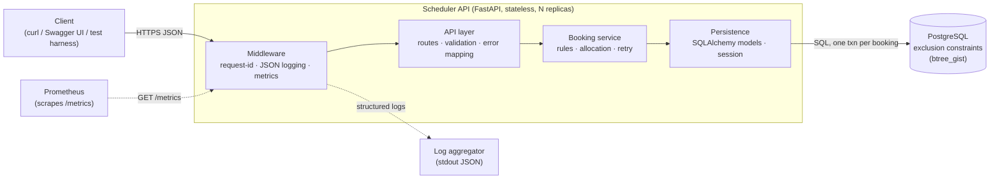
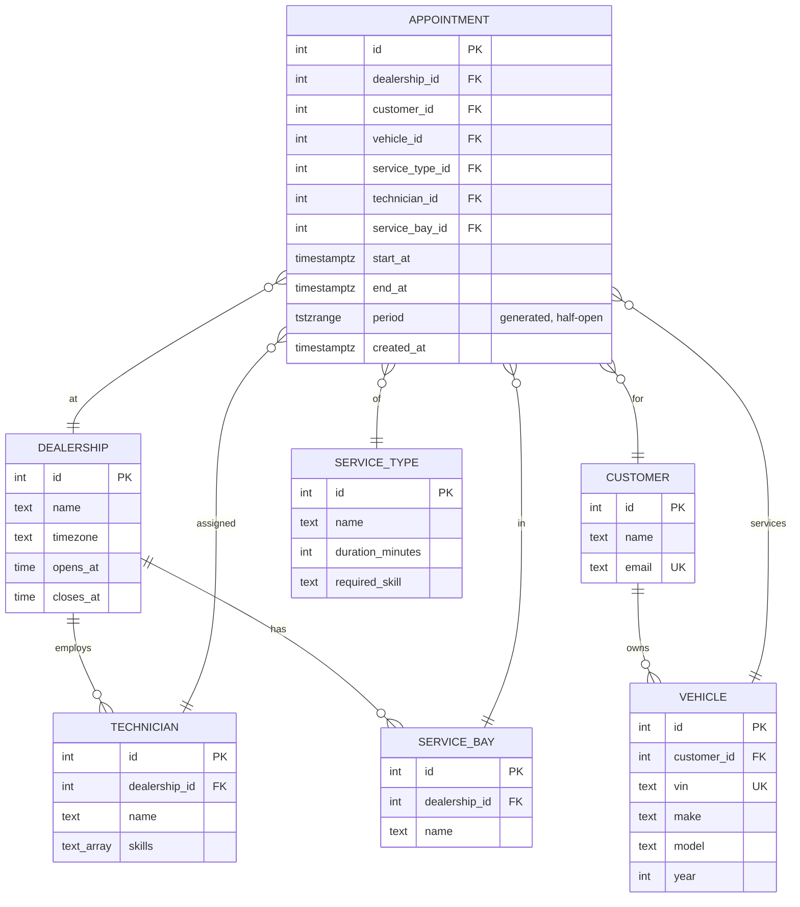
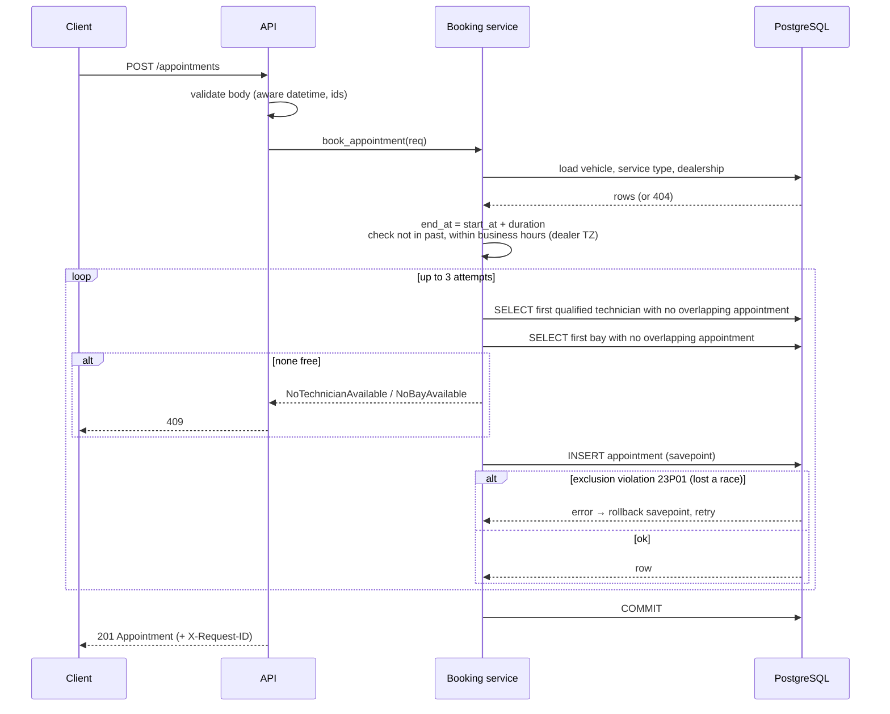

# Unified Service Scheduler — System Design

Keyloop Technical Assessment · Scenario A (Ownership domain) · Backend implementation

## 1. Problem & Scope

Dealerships book service appointments manually, which leads to double-booked
technicians and service bays. This service lets a client request an appointment
for a **vehicle**, **service type**, **dealership** and **desired start time**. It
confirms the appointment only if a **qualified technician** and a **service bay**
are both free for the **entire service duration**, and persists the result.

**In scope (implemented)**

| Requirement | How it is met |
|---|---|
| 1. Resource-constrained booking | `POST /appointments` with `vehicle_id`, `service_type_id`, `dealership_id`, `start_at` |
| 2. Real-time availability check | Inside the same DB transaction as the insert: find a free qualified technician + free bay; PostgreSQL exclusion constraints make double-booking impossible even under concurrency |
| 3. Confirmed appointment record | `appointments` row linking customer, vehicle, technician, service bay, service type, dealership |

**Out of scope (deliberately not built — see §11 Future Work)**
Authentication, cancellation/rescheduling, a "find me free slots" search, customer/vehicle
CRUD (seeded instead), notifications, frontend UI.

## 2. Assumptions

The brief is ambiguous in places; these are the decisions taken.

1. **Duration comes from the service type** (`duration_minutes`); the client sends only a start time.
2. **Qualification = skill match.** Each service type requires one skill (e.g. `brakes`);
   a technician is qualified if that skill is in their `skills` list.
3. **The system allocates** the technician and bay; the customer does not choose them.
   Allocation is deterministic (lowest id first) — fair-load balancing is future work.
4. **Technicians and bays belong to one dealership.**
5. **Business hours:** each dealership has one opening window (e.g. 08:00–18:00) in its own
   IANA timezone, every day. An appointment must start and end inside it on the same local day.
6. **Times:** clients must send ISO-8601 with an offset (`2026-11-10T09:00:00+00:00`).
   Naive timestamps are rejected. Everything is stored as UTC `timestamptz`.
7. **Intervals are half-open `[start, end)`**: a 09:00–10:00 booking does not block a 10:00 start.
8. **Customers and vehicles already exist** (seed data); the customer is derived from the vehicle.
9. **No booking in the past.**
10. Every appointment is confirmed at creation (no pending/hold state, no cancellation yet), so
    every row blocks its resources.

## 3. Architecture



### Component roles

| Component | Responsibility |
|---|---|
| **Middleware** | Assigns/propagates `X-Request-ID`, emits one JSON access log per request, records latency histogram. |
| **API layer** (`api.py`, `schemas.py`) | HTTP contract. Pydantic validates input (aware datetimes, positive ids). Maps domain errors to HTTP status + stable error codes. Auto-generates the OpenAPI spec (`/docs`), which serves as the client stub required by the brief. |
| **Booking service** (`booking.py`) | All business rules: compute end time, business hours, not-in-past, find a free qualified technician and a free bay, insert, retry on lost races. Pure functions are separated from DB-touching ones so rules are unit-testable without a database. |
| **Persistence** (`models.py`, `db.py`) | Schema, constraints, session-per-request. |
| **PostgreSQL** | Source of truth **and** the final guard against double-booking via `EXCLUDE USING gist`. |

## 4. Data Model



**Key constraints on `appointments`:**

```sql
CREATE EXTENSION IF NOT EXISTS btree_gist;
-- period = tstzrange(start_at, end_at, '[)')  (generated column)
CHECK (end_at > start_at)
CONSTRAINT no_technician_overlap EXCLUDE USING gist (technician_id WITH =, period WITH &&)
CONSTRAINT no_bay_overlap        EXCLUDE USING gist (service_bay_id WITH =, period WITH &&)
```

The GiST indexes behind these constraints also make the "is this resource busy?" lookups fast.

## 5. API Contract

| Method & path | Purpose | Responses |
|---|---|---|
| `POST /appointments` | Check availability and book atomically | `201` Appointment · `404` unknown vehicle/service type/dealership · `409` no capacity · `422` invalid input / rule violation |
| `GET /appointments/{id}` | Fetch one appointment | `200` · `404` |
| `GET /appointments?dealership_id=&date=` | List a dealership's appointments for a local date | `200` |
| `GET /health` | Liveness + DB ping | `200` / `503` |
| `GET /metrics` | Prometheus metrics | `200` |
| `GET /docs`, `/openapi.json` | Generated OpenAPI contract | `200` |

**Request**

```json
POST /appointments
{ "vehicle_id": 1, "service_type_id": 2, "dealership_id": 1, "start_at": "2026-11-10T09:00:00+00:00" }
```

**Response 201**

```json
{ "id": 42, "dealership_id": 1, "customer_id": 1, "vehicle_id": 1, "service_type_id": 2,
  "technician_id": 1, "service_bay_id": 1,
  "start_at": "2026-11-10T09:00:00Z", "end_at": "2026-11-10T11:00:00Z",
  "created_at": "2026-11-03T12:00:00Z" }
```

**Errors** always use one shape, so clients can branch on `code`:

```json
{ "error": { "code": "no_technician_available", "message": "No qualified technician is free 09:00–11:00" } }
```

| `code` | HTTP |
|---|---|
| `not_found` | 404 |
| `validation_error`, `start_in_past`, `outside_business_hours` | 422 |
| `no_technician_available`, `no_bay_available`, `slot_taken` | 409 |

> **Why no separate `GET /availability` endpoint?** An availability answer is stale the
> moment it is returned (time-of-check vs time-of-use). The requirement "check before
> confirming" is met by doing check + insert in one transaction. A slot-search endpoint is
> listed as future work for UX, not for correctness.

## 6. Data Flow — Booking



### Concurrency strategy (the core design decision)

Two clients can see the same technician as free at the same moment. Options considered:

| Option | Verdict |
|---|---|
| Check in app, then insert | **Rejected** — race window, double-booking under load. |
| `SERIALIZABLE` isolation | Works, but aborts many unrelated transactions under load and needs a generic retry. |
| `SELECT … FOR UPDATE` on technician/bay rows | Works, but serialises all bookings for a resource, even non-overlapping ones, and is easy to get wrong in later code. |
| **Exclusion constraint + optimistic retry** | **Chosen.** The database rejects overlapping ranges atomically. App code stays simple, and correctness doesn't depend on every future code path remembering to lock. Losing a race costs one retry. |

## 7. Technology Choices

| Technology | Why |
|---|---|
| **Python 3.14 + uv** | Repo baseline; uv gives fast, reproducible, lockfile-based installs. |
| **FastAPI** | Typed request validation via Pydantic, OpenAPI generated for free (satisfies the "API contract" client stub), mature and fast. |
| **SQLAlchemy 2.0 (sync) + psycopg 3** | Explicit transactions and savepoints; first-class `ExcludeConstraint` / `TSTZRANGE` support. Sync keeps the code simple; the bottleneck is the DB, not the Python event loop. |
| **PostgreSQL 17** | Range types + `EXCLUDE` constraints solve double-booking at the data layer; nothing comparable in SQLite/MySQL. |
| **prometheus-client** | De-facto metrics standard; one `/metrics` endpoint. |
| **stdlib `logging` with a JSON formatter** | Structured logs without another dependency. |
| **pytest + FastAPI TestClient** | Unit tests for pure rules; integration tests against real Postgres (constraints can't be faked). |
| **Docker Compose** | One command brings up Postgres + API for reviewers. |
| **tzdata** | `zoneinfo` needs it on Windows, where there's no system tz database. |

## 8. Observability

| Pillar | Implementation |
|---|---|
| **Logging** | JSON lines on stdout: `ts, level, msg, request_id, method, path, status, duration_ms`. Domain events: `appointment_booked` (ids, start/end) and `appointment_rejected` (reason). No customer PII (only ids) in logs. |
| **Correlation** | `X-Request-ID` accepted from the caller or generated (uuid4), stored in a `contextvar`, included in every log line, and echoed in the response header. |
| **Metrics** | `appointments_booked_total`; `appointment_booking_rejected_total{reason}`; `appointment_booking_retries_total`; `http_request_duration_seconds{method,route,status}` histogram. These give booking success rate, contention rate (retries), and latency SLOs (p95 < 300 ms target). |
| **Health** | `GET /health` pings the DB; used for container/k8s liveness and readiness. |
| **Tracing (designed, not built)** | OpenTelemetry auto-instrumentation for FastAPI + SQLAlchemy, exporting OTLP to Jaeger/Tempo. The request id would become a span attribute. Not built because a single service with one DB hop gains little from traces today. |

Suggested alerts: rejection rate for `slot_taken` > 5% (contention), p95 latency > 300 ms, `/health` failing.

## 9. Non-Functional Considerations

- **Scalability:** the API is stateless, so it scales horizontally behind a load balancer. All
  coordination happens in Postgres via constraints, so no distributed lock is needed. Contention is
  per technician/bay and therefore naturally sharded by dealership. If it grows, partition
  `appointments` by dealership and add read replicas for the `GET` endpoints.
- **Performance:** one transaction per booking, ~5 indexed queries. GiST indexes serve the overlap
  lookups. A connection pool (SQLAlchemy defaults) is used.
- **Reliability:** correctness is enforced by the DB, not app memory. Bounded retries (3) mean no
  unbounded loops. `/health` supports orchestration. Future: an `Idempotency-Key` header so that
  client retries after a timeout don't create duplicate bookings.
- **Maintainability:** layered modules (API → service → models). Pure rule functions are
  unit-tested. Stable error codes. The OpenAPI spec is the contract.
- **Security:** Pydantic validation at the trust boundary; parameterised SQL only (ORM); no PII in
  logs; secrets via env vars. Auth (OAuth2/JWT per dealership) is future work and would scope every
  query by `dealership_id`.

## 10. How GenAI Was Used in Design

*(Author: refine this with your own words and specific moments before submitting.)*

- **Scenario selection:** I asked an AI agent (Claude Code) to compare the four scenarios against
  the evaluation criteria. It recommended A because it has the most real business logic and a
  concurrency problem worth designing around. I agreed after checking that B and C are mostly CRUD.
- **Design drafting:** the agent drafted this document and the implementation plan from my
  direction (backend only, FastAPI + Postgres, minimal scope). I constrained scope explicitly:
  no auth, no cancellation, no slot search.
- **Challenging the AI:** the key decision, preventing double-booking, was reviewed against the
  alternatives in §6. I verified the exclusion-constraint approach against PostgreSQL docs
  (`btree_gist`, half-open `tstzrange`). The plan includes a test that proves the constraint fires
  under truly concurrent requests, rather than trusting the claim.
- **Assumptions:** the AI listed ambiguities; I chose the resolutions in §2.

## 11. Future Work

Cancellation/rescheduling (add `status`, make constraints partial `WHERE status = 'confirmed'`) ·
free-slot search endpoint · `Idempotency-Key` · per-day opening hours and holidays · technician
shifts/breaks · load-balanced allocation · authentication and dealership scoping · OpenTelemetry
tracing · Alembic migrations (replacing `create_all`).
