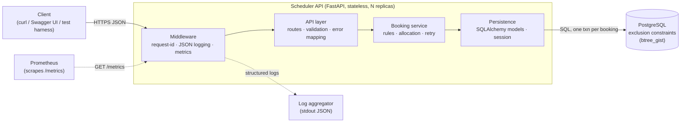
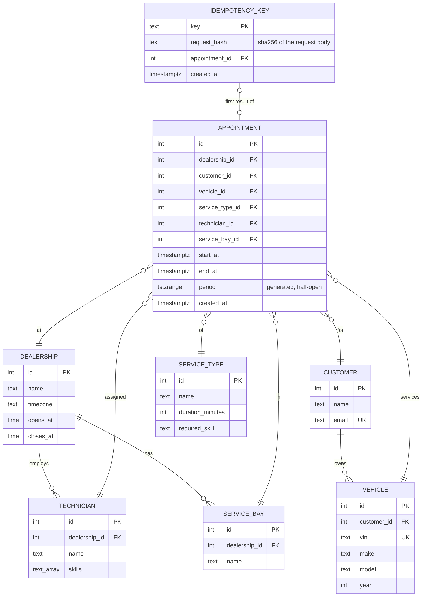
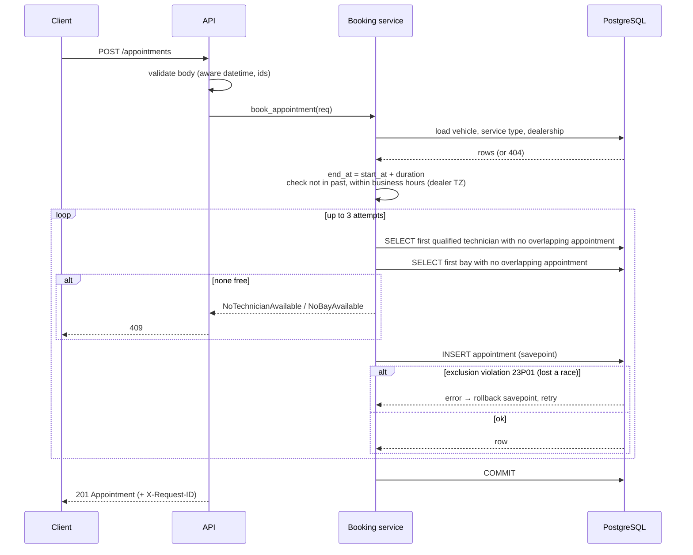

# Unified Service Scheduler — System Design

Keyloop Technical Assessment · Scenario A (Ownership domain) · Backend implementation

## 1. Problem & Scope

Dealerships book service appointments manually, which leads to double-booked
technicians and service bays. This service lets a client request an appointment
for a **vehicle**, **service type**, **dealership** and **desired start time**. It
confirms the appointment only if a **qualified technician** and a **service bay**
are both free for the **entire service duration**, and persists the result.

**In scope (implemented)**

| Requirement | How it is met |
|---|---|
| 1. Resource-constrained booking | `POST /appointments` with `vehicle_id`, `service_type_id`, `dealership_id`, `start_at` |
| 2. Real-time availability check | Inside the same DB transaction as the insert: find a free qualified technician + free bay; PostgreSQL exclusion constraints make double-booking impossible even under concurrency |
| 3. Confirmed appointment record | `appointments` row linking customer, vehicle, technician, service bay, service type, dealership |

**Out of scope (deliberately not built — see §12 Future Work)**
Authentication, cancellation/rescheduling, a "find me free slots" search, customer/vehicle
CRUD (seeded instead), notifications, frontend UI.

## 2. Assumptions

The brief is ambiguous in places; these are the decisions taken.

1. **Duration comes from the service type** (`duration_minutes`); the client sends only a start time.
2. **Qualification = skill match.** Each service type requires one skill (e.g. `brakes`);
   a technician is qualified if that skill is in their `skills` list.
3. **The system allocates** the technician and bay; the customer does not choose them.
   Allocation is deterministic (lowest id first) — fair-load balancing is future work.
4. **Technicians and bays belong to one dealership.**
5. **Business hours:** each dealership has one opening window (e.g. 08:00–18:00) in its own
   IANA timezone, every day. An appointment must start and end inside it on the same local day.
6. **Times:** clients must send ISO-8601 with an offset (`2026-11-10T09:00:00+00:00`).
   Naive timestamps are rejected. Everything is stored as UTC `timestamptz`.
7. **Intervals are half-open `[start, end)`**: a 09:00–10:00 booking does not block a 10:00 start.
8. **Customers and vehicles already exist** (seed data); the customer is derived from the vehicle.
9. **No booking in the past.**
10. Every appointment is confirmed at creation (no pending/hold state, no cancellation yet), so
    every row blocks its resources.
11. **Service bays are interchangeable** within a dealership: any bay can host any service type.
    Bay capabilities (e.g. EV lift) are future work and would mirror the technician-skill match.
12. **Idempotency keys are global and never expire** (there's no auth, so no per-client scoping).
    Clients should use random UUIDs. Only successful bookings are remembered.

## 3. Architecture



### Component roles

| Component | Responsibility |
|---|---|
| **Middleware** | Assigns/propagates `X-Request-ID`, emits one JSON access log per request, records latency histogram. |
| **API layer** (`api.py`, `schemas.py`) | HTTP contract. Pydantic validates input (aware datetimes, positive ids). Maps domain errors to HTTP status + stable error codes. Auto-generates the OpenAPI spec (`/docs`), which serves as the client stub required by the brief. |
| **Booking service** (`booking.py`) | All business rules: compute end time, business hours, not-in-past, find a free qualified technician and a free bay, insert, retry on lost races. Pure functions are separated from DB-touching ones so rules are unit-testable without a database. |
| **Persistence** (`models.py`, `db.py`) | Schema, constraints, session-per-request. |
| **PostgreSQL** | Source of truth **and** the final guard against double-booking via `EXCLUDE USING gist`. |

## 4. Data Model



**Key constraints on `appointments`:**

```sql
CREATE EXTENSION IF NOT EXISTS btree_gist;
-- period = tstzrange(start_at, end_at, '[)')  (generated column)
CHECK (end_at > start_at)
CONSTRAINT no_technician_overlap EXCLUDE USING gist (technician_id WITH =, period WITH &&)
CONSTRAINT no_bay_overlap        EXCLUDE USING gist (service_bay_id WITH =, period WITH &&)
-- resources must belong to the appointment's dealership (technicians/service_bays have UNIQUE (id, dealership_id))
FOREIGN KEY (technician_id, dealership_id)  REFERENCES technicians (id, dealership_id)
FOREIGN KEY (service_bay_id, dealership_id) REFERENCES service_bays (id, dealership_id)
```

The GiST indexes behind these constraints also make the "is this resource busy?" lookups fast.
Every invariant that can be stated declaratively (no overlap, same dealership, valid interval)
lives in the database, so a future bug or a second writer can't break it. Rules that need
context (skill match, business hours, not in the past) live in the booking service.

## 5. API Contract

| Method & path | Purpose | Responses |
|---|---|---|
| `POST /appointments` | Check availability and book atomically. Optional `Idempotency-Key` header (see below) | `201` Appointment · `404` unknown vehicle/service type/dealership · `409` no capacity · `422` invalid input / rule violation / key reused |
| `GET /appointments/{id}` | Fetch one appointment | `200` · `404` |
| `GET /appointments?dealership_id=&date=` | List a dealership's appointments for a local date (both params required) | `200` · `422` |
| `GET /health/live` | Liveness: the process is up (no DB call) | `200` |
| `GET /health/ready` | Readiness: DB reachable (`SELECT 1`) | `200` / `503` |
| `GET /metrics` | Prometheus metrics | `200` |
| `GET /docs`, `/openapi.json` | Generated OpenAPI contract | `200` |

**Request**

```json
POST /appointments
{ "vehicle_id": 1, "service_type_id": 2, "dealership_id": 1, "start_at": "2026-11-10T09:00:00+00:00" }
```

**Response 201**

```json
{ "id": 42, "dealership_id": 1, "customer_id": 1, "vehicle_id": 1, "service_type_id": 2,
  "technician_id": 1, "service_bay_id": 1,
  "start_at": "2026-11-10T09:00:00Z", "end_at": "2026-11-10T11:00:00Z",
  "created_at": "2026-11-03T12:00:00Z" }
```

**Errors** always use one shape, so clients can branch on `code`:

```json
{ "error": { "code": "no_technician_available", "message": "No qualified technician is free 09:00–11:00" } }
```

| `code` | HTTP |
|---|---|
| `not_found` | 404 |
| `validation_error`, `start_in_past`, `outside_business_hours`, `idempotency_key_reused` | 422 |
| `no_technician_available`, `no_bay_available`, `slot_taken` | 409 |
| `service_unavailable` (DB pool/lock/statement/connect timeout, DB down) | 503 |
| `internal_error` (unexpected bug; logged with the request id, no internals in the body) | 500 |

Every route documents these responses with the `ErrorResponse` schema in the generated OpenAPI spec.

### Idempotent retries (`Idempotency-Key`)

**Problem:** a client that times out and resends a booking would otherwise book *again*. The
first request took Alice, so the retry quietly takes Bob, and one car ends up with two
appointments at the same time.

**Contract:** `POST /appointments` accepts an optional `Idempotency-Key` header (1–255 printable
ASCII characters, e.g. a UUID).

| Situation | Result |
|---|---|
| New key | Booked normally, and the key is linked to the new appointment |
| Same key, same body | `201` with the **original** appointment and the header `Idempotent-Replayed: true`. Nothing new is booked |
| Same key, different body | `422 idempotency_key_reused` |
| Same key, first request **failed** (409/422/404) | Nothing was stored, so the retry is a fresh attempt |
| Same key, two requests **at the same time** | The second waits until the first commits, then replays its result. Exactly one booking |

**How:** the key row is claimed with `INSERT … ON CONFLICT DO NOTHING` as the first statement of
the booking transaction. It's linked to the appointment just before the same `COMMIT`, so the key
and the booking are always written together or not at all. A concurrent request with the same
key blocks on the primary key instead of racing. The stored value is the appointment id, not a
response copy, so a replay can never disagree with the database. The body is compared through a
SHA-256 hash of its canonical JSON.

> **Why no separate `GET /availability` endpoint?** An availability answer is stale the
> moment it is returned (time-of-check vs time-of-use). The requirement "check before
> confirming" is met by doing check + insert in one transaction. A slot-search endpoint is
> listed as future work for UX, not for correctness.

## 6. Data Flow — Booking



### Concurrency strategy (the core design decision)

Two clients can see the same technician as free at the same moment. Options considered:

| Option | Verdict |
|---|---|
| Check in app, then insert | **Rejected** — race window, double-booking under load. |
| `SERIALIZABLE` isolation | Works, but aborts many unrelated transactions under load and needs a generic retry. |
| `SELECT … FOR UPDATE` on technician/bay rows | Works, but serialises all bookings for a resource, even non-overlapping ones, and is easy to get wrong in later code. |
| **Exclusion constraint + optimistic retry** | **Chosen.** The database rejects overlapping ranges atomically. App code stays simple, and correctness doesn't depend on every future code path remembering to lock. Losing a race costs one retry. |

## 7. Technology Choices

| Technology | Why |
|---|---|
| **Python 3.14 + uv** | Repo baseline; uv gives fast, reproducible, lockfile-based installs. |
| **FastAPI** | Typed request validation via Pydantic, OpenAPI generated for free (satisfies the "API contract" client stub), mature and fast. |
| **SQLAlchemy 2.0 (sync) + psycopg 3** | Explicit transactions and savepoints; first-class `ExcludeConstraint` / `TSTZRANGE` support. Sync keeps the code simple; the bottleneck is the DB, not the Python event loop. |
| **PostgreSQL 17** | Range types + `EXCLUDE` constraints solve double-booking at the data layer; nothing comparable in SQLite/MySQL. |
| **prometheus-client** | De-facto metrics standard; one `/metrics` endpoint. |
| **stdlib `logging` with a JSON formatter** | Structured logs without another dependency. |
| **pytest + FastAPI TestClient** | Unit tests for pure rules; integration tests against real Postgres (constraints can't be faked). |
| **Docker Compose** | One command brings up Postgres + API for reviewers. |
| **tzdata** | `zoneinfo` needs it on Windows, where there's no system tz database. |

## 8. Observability

| Pillar | Implementation |
|---|---|
| **Logging** | JSON lines on stdout: `ts, level, msg, request_id, method, path, status, duration_ms`. Domain events: `appointment_booked` (ids, start/end), `appointment_rejected` (reason) and `appointment_replayed` (idempotent retry). No customer PII (only ids) in logs. |
| **Correlation** | `X-Request-ID` accepted from the caller or generated (uuid4), stored in a `contextvar`, included in every log line, and echoed in the response header. |
| **Metrics** | `appointments_booked_total`; `appointment_booking_rejected_total{reason}`; `appointment_booking_retries_total`; `appointment_idempotent_replays_total`; `http_request_duration_seconds{method,route,status}` histogram. These give booking success rate, contention rate (retries), client retry rate (replays), and latency SLOs (p95 < 300 ms target). |
| **Health** | `/health/live` (process only) for liveness probes. `/health/ready` (DB ping) for readiness, so a DB outage takes replicas out of rotation instead of restart-looping them. |
| **Tracing (designed, not built)** | OpenTelemetry auto-instrumentation for FastAPI + SQLAlchemy, exporting OTLP to Jaeger/Tempo. The request id would become a span attribute. Not built because a single service with one DB hop gains little from traces today. |

Suggested alerts: `rate(appointment_booking_retries_total)` / booking rate > 5% (contention: a
request that loses a race usually ends as `no_technician_available` after retrying, not as
`slot_taken`), p95 latency > 300 ms, `/health/ready` failing. Business signal: a rising
`no_*_available` rejection share means a dealership is short of capacity.

## 9. Non-Functional Considerations

- **Scalability:** the API is stateless, so it scales horizontally behind a load balancer. All
  coordination happens in Postgres via constraints, so no distributed lock is needed. Contention is
  per technician/bay and therefore naturally sharded by dealership. If it grows, partition
  `appointments` by dealership and add read replicas for the `GET` endpoints.
- **Performance:** one short transaction per booking, ~5 indexed queries. GiST indexes serve the
  overlap lookups. The SQLAlchemy pool is sized via env (`DB_POOL_SIZE`, default 10, overflow 10).
  This matters because sync FastAPI endpoints run on a 40-thread pool; requests beyond the pool
  wait up to `pool_timeout` (5 s) and then fail fast with 503 instead of hanging.
- **Reliability:** correctness is enforced by the DB, not app memory. A request that loses a race
  waits on the winner's row lock until that transaction ends; `lock_timeout=2s` and
  `statement_timeout=5s` (set per connection) cap that wait, and `connect_timeout=3s` stops an
  unreachable DB host from hanging new connections (measured: >90 s without it). Bounded retries (3) mean no unbounded
  loops. Health endpoints support orchestration. An `Idempotency-Key` header makes client
  retries after a timeout safe: they replay the original booking instead of creating a second one
  (§5).
- **Maintainability:** layered modules (API → service → models). Pure rule functions are
  unit-tested. Stable error codes. The OpenAPI spec is the contract.
- **Security:** Pydantic validation at the trust boundary; parameterised SQL only (ORM); no PII in
  logs; secrets via env vars. Auth (OAuth2/JWT per dealership) is future work and would scope every
  query by `dealership_id`.

## 10. How GenAI Was Used in Design

> **TODO(author):** the bullets below record what happened in the AI session. Items marked
> ☐ are verification steps that only count once *you* have done them. Do them, then rewrite
> the section in your own words.

- **Scenario selection:** I asked an AI agent (Claude Code) to compare the four scenarios against
  the evaluation criteria. It recommended A for its real business logic and a concurrency problem
  worth designing around; B and C are mostly CRUD.
- **Directing scope:** I set the constraints (backend only, smallest version that meets the three
  requirements). The agent drafted this document and a task-by-task, test-first implementation plan.
- **Reviewing the AI's draft:** a second review pass over the AI's first draft found and fixed
  real gaps: no DB-level guard against cross-dealership resources, a health check that would
  restart-loop pods during a DB outage, an alert on a metric that would rarely fire, no lock or pool
  timeouts, and a test fixture the plan referenced but never defined.
- ☐ **Verify the core claim yourself:** read the PostgreSQL docs on exclusion constraints,
  `btree_gist` and `tstzrange` bounds. The plan's DB-level and concurrent tests must pass before
  this design is trusted.
- ☐ **Assumptions:** confirm or change each resolution in §2. These are product decisions, and
  you own them.

## 11. Testing Strategy

| Layer | What it proves | DB? |
|---|---|---|
| Rule unit tests | duration, not-in-past, business hours across timezones and DST | no |
| Constraint tests | the DB itself rejects overlaps, cross-dealership resources and bad intervals, and allows back-to-back bookings | yes |
| Service tests | allocation (skill match, fallback, dealership scoping), every error path, retry after a lost race | yes |
| Concurrency test | two truly simultaneous requests for the last slot → exactly one booking | yes |
| Idempotency tests | same key replays without re-booking, key reuse with another body is rejected, a failed attempt doesn't consume the key, two concurrent same-key requests → one booking | yes |
| API tests | status codes, error shape, timezone handling, request id, metrics | yes |

Integration tests run against real PostgreSQL (Docker), not SQLite or mocks, because the
central guarantee is a Postgres feature.

## 12. Future Work

Cancellation/rescheduling (add `status`, make constraints partial `WHERE status = 'confirmed'`) ·
free-slot search endpoint · expiry for idempotency keys (TTL cleanup, e.g. 24 h) · a per-vehicle
overlap constraint, so even retries *without* a key can't double-book a car · per-day opening hours and holidays · technician
shifts/breaks · load-balanced allocation · authentication and dealership scoping · OpenTelemetry
tracing · Alembic migrations (replacing `create_all`).
